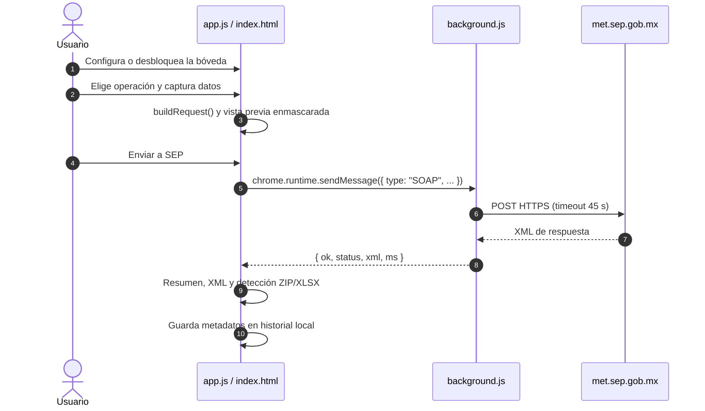

# Éxodo — Extensión Chrome/Edge

**Gestión abierta de títulos electrónicos ante la SEP**

Éxodo es una herramienta gratuita y de código abierto para instituciones educativas de México. Está desarrollada por **CLA Tech** y permite **cargar, consultar, descargar y cancelar** títulos electrónicos mediante las cinco solicitudes SOAP de SEP/MET. Nació como una solución para UPMYS, pero es independiente y reutilizable por cualquier universidad: cada institución puede definir el nombre que se muestra localmente desde **Configuración**, sin modificar el código fuente.

Es un proyecto independiente, no afiliado ni certificado por la SEP, y requiere credenciales institucionales autorizadas. Busca reducir la dependencia de proveedores externos, permitiendo que las instituciones gestionen directamente sus operaciones ante los servicios oficiales de la SEP.

Es un **prototipo funcional**; las pruebas reales descritas aquí son resultados reportados por el usuario y no constituyen una validación formal de producción o del WSDL. No usa librerías externas ni proceso de compilación.

Documentación relacionada:

- [Manual de usuario](docs/MANUAL_DE_USUARIO.md)
- [Notas de diseño UI/UX](docs/DISENO_UI.md)
- [Guía para contribuir](CONTRIBUTING.md)
- [Política de seguridad](SECURITY.md)
- [Historial de cambios](CHANGELOG.md)
- [Licencia MIT](LICENSE)

## Estado

- Versión del manifiesto: `1.1.0`.
- Interfaz con la paleta institucional.
- El usuario reportó pruebas exitosas en el entorno disponible: envío de varios XML, recepción de identificadores/folios y consulta o descarga con esos identificadores con resultados reales; también reportó funcionamiento de todas las operaciones. No se registraron la fecha ni la identificación del entorno; la validación formal del WSDL no está documentada.
- Las operaciones de carga y cancelación pueden tener efectos reales.

## Adopción rápida

El repositorio existente se identifica como `CLA-Titulos-SEP`; ese nombre y su dirección de GitHub se conservan. Para probarlo localmente:

```bash
git clone https://github.com/AngelCLA/CLA-Titulos-SEP.git
cd CLA-Titulos-SEP
```

Después sigue la [instalación](#instalación) y consulta el [manual de usuario](docs/MANUAL_DE_USUARIO.md). Para proponer mejoras, revisa la [guía para contribuir](CONTRIBUTING.md).

## Requisitos

- Chrome o Edge de escritorio con soporte para Manifest V3.
- Acceso HTTPS a `https://met.sep.gob.mx/*`.
- Credenciales SEP/MET válidas.
- Un archivo XML generado por SATE, o un ZIP que contenga varios, para la operación de carga.

## Instalación

1. Descomprime la carpeta del proyecto.
2. Abre `chrome://extensions` o `edge://extensions`.
3. Activa **Modo desarrollador**.
4. Pulsa **Cargar descomprimida** y selecciona la carpeta que contiene `manifest.json`.
5. Pulsa el icono de la extensión. Se abre `index.html` en una pestaña nueva.
6. Configura la bóveda de credenciales en el primer uso.

## Uso rápido

1. **Configura la bóveda**: usuario y contraseña SEP + contraseña maestra de 12 caracteres o más.
2. **Desbloquea** la bóveda con la contraseña maestra.
3. Elige una operación en la barra lateral.
4. Completa los campos o selecciona el XML. Para cargar un título puedes elegir un `.xml` o un `.zip` con varios XML: el ZIP se descomprime en el navegador y **nunca se envía**, cada XML se envía en una solicitud SOAP independiente y genera su propio lote. Cada XML debe ser `.xml` y no superar el límite local inclusivo de 1 MiB (1.048.576 bytes); los mayores se rechazan antes de leerse o enviarse. Este límite no representa una política oficial de SEP.
5. Usa **Ver solicitud SOAP** para revisar la solicitud enmascarada, sin enviarla.
6. Pulsa **Enviar a SEP**.
7. Revisa el resumen, la tabla de resultados, el XML y las descargas.

El detalle paso a paso está en el [manual de usuario](docs/MANUAL_DE_USUARIO.md).

## Operaciones

| Operación | Datos de entrada | Comportamiento |
| --- | --- | --- |
| Cargar título | Uno o varios XML de SATE (`.xml` o `.zip`) de hasta 1 MiB cada uno | Comprueba que cada XML sea parseable, que la raíz sea `TituloElectronico` y que tenga `folioControl`. El límite local inclusivo es 1 MiB (1.048.576 bytes) por XML; uno mayor se rechaza antes de leerse o enviarse. Un `.zip` de hasta 50 MiB se descomprime localmente, se filtran sus `.xml` y se envía **una solicitud SOAP por XML**, con el nombre y el contenido Base64 de cada archivo; el ZIP nunca se transmite. Los XML inválidos se reportan y no bloquean al resto. Este límite no representa una política oficial de SEP. |
| Consultar lote | Número de lote | Valida un entero positivo. Puede detectar un ZIP en Base64 dentro de la respuesta. |
| Descargar lote | Número de lote | Igual que consulta; si detecta un ZIP, intenta leer el XLSX y mostrar la tabla de resultados. |
| Cancelar título | Folio de control + motivo | Pide confirmación explícita antes de enviar una cancelación real. |
| Cancelar por institución | Folio + clave de institución + motivo | Pide confirmación explícita antes de enviar una cancelación real. |
| Historial de lotes | — | Tabla agrupada por número de lote con fecha de creación, última consulta y última descarga, más acciones **Consultar**, **Descargar** y **Cancelar** que se ejecutan en el mismo panel. Conserva hasta 250 movimientos locales y muestra aparte las operaciones sin lote. |

## Estructura del proyecto

```text
CLA-Titulos-SEP/
├─ manifest.json          Configuración Manifest V3, permisos y service worker
├─ background.js          Envío SOAP, allowlist del endpoint y timeout
├─ index.html             Estructura de la interfaz
├─ style.css              Tema institucional y estilos responsive
├─ app.js                 Estado de la UI, SOAP, ZIP/XLSX, bóveda e historial
├─ assets/                Recursos locales de la interfaz
├─ tests/                 Pruebas deterministas con dobles locales
├─ design/                Sistema visual y propuestas de componentes
├─ README.md              Este documento
├─ CONTRIBUTING.md        Flujo de contribución
├─ SECURITY.md            Reporte responsable y precauciones
├─ LICENSE                Licencia MIT
└─ docs/
   ├─ MANUAL_DE_USUARIO.md
   └─ DISENO_UI.md
```

| Archivo | Responsabilidad |
| --- | --- |
| `manifest.json` | Declara Manifest V3, permiso `storage`, `host_permissions` para `https://met.sep.gob.mx/*`, el service worker y la CSP de las páginas de la extensión. |
| `background.js` | Recibe mensajes `{ type: "SOAP", endpoint, xml }`, valida que el endpoint sea exactamente `https://met.sep.gob.mx/met-ws/services/`, hace el `POST` y devuelve `{ ok, status, xml, ms }` o un error `{ ok: false, uncertain: true, error, ms }` cuando no puede confirmar el resultado del transporte. |
| `index.html` | Header, navegación lateral, paneles de operación y respuesta, bóveda y contenedores de resultados. |
| `style.css` | Tokens de la paleta institucional, componentes, estados y breakpoints. |
| `app.js` | Cambio de pestañas, construcción de solicitudes, vista previa enmascarada, envío, resumen, detección de ZIP, lectura de XLSX, bóveda cifrada e historial. |

## Arquitectura y flujo



### Solicitud SOAP

- Namespace de operaciones: `http://ws.web.mec.sep.mx/schemas`.
- Envelope: `http://schemas.xmlsoap.org/soap/envelope/`.
- Operaciones:

| Pestaña | Elemento de solicitud |
| --- | --- |
| Cargar | `cargaTituloElectronicoRequest` |
| Consultar | `consultaProcesoTituloElectronicoRequest` |
| Descargar | `descargaTituloElectronicoRequest` |
| Cancelar título | `cancelaTituloElectronicoRequest` |
| Cancelar por institución | `cancelarTituloInstitucionRequest` |

- La autenticación viaja dentro de `<autenticacion>` con `<usuario>` y `<password>`.
- La vista previa oculta la contraseña y el Base64 del archivo. La solicitud real sí incluye ambos.
- `SOAPAction` se envía como `""` por defecto. Está pendiente de validar contra el WSDL.

### Respuesta y resultados

- El resumen intenta extraer `numeroLote`, `faultstring`/`Text`, `estatusLote`/`codigo`/`codigoRespuesta`/`estatus` y `mensaje`/`mensajeRespuesta`/`descripcion`.
- La detección de ZIP es heurística: busca un elemento Base64 que empiece por `UEs` y cuyos primeros bytes sean la firma ZIP (`PK`).
- Si el ZIP contiene un XLSX, se lee localmente en el navegador. Se buscan las columnas **Archivo**, **Estatus**, **Descripción** y **Folio control**.
- Los estatus `1` y `2` se muestran como correcto y error, respectivamente, según el flujo operativo descrito.
- La tabla muestra hasta 2000 filas. El ZIP se puede descargar aunque el XLSX no se pueda interpretar.
- Estas heurísticas no garantizan que todos los lotes usen el mismo formato.

## Seguridad y privacidad

### Credenciales

- Se guardan **solo cifradas** en `chrome.storage.local`, bajo la clave `sepCredentialVaultV1`.
- Cifrado: AES-256-GCM con clave derivada por PBKDF2-SHA256, 310 000 iteraciones, salt de 16 bytes e IV de 12 bytes aleatorios.
- La contraseña maestra y la clave derivada **no se persisten**.
- Al desbloquear, el usuario y la contraseña SEP viven en memoria de la pestaña. **Bloquear**, en la cabecera, borra esa referencia.
- La contraseña maestra **no se puede recuperar**. Si se pierde, hay que borrar la bóveda y configurar credenciales nuevas.
- Cuando la API está disponible, se llama a `chrome.storage.local.setAccessLevel({ accessLevel: "TRUSTED_CONTEXTS" })` para restringir el acceso desde content scripts.

### Historial

- Se guarda en `chrome.storage.local`, sin cifrado a nivel de aplicación.
- Conserva hasta 250 movimientos con metadatos y resultados parseados.
- La vista agrupa esos movimientos por número de lote al mostrarlos (creación, última consulta, última descarga) sin cambiar el formato almacenado.
- Las acciones del historial reutilizan las mismas solicitudes SOAP que los paneles laterales y registran el resultado de cada ejecución.
- El XML SOAP completo de respuesta **no se persiste**; el campo `response` de los registros nuevos queda vacío.
- El XML de solicitud no se persiste.
- El historial puede contener datos personales. Se recomienda un perfil institucional controlado, evitar equipos compartidos y definir una política de retención.

### Red

- El service worker solo permite el endpoint exacto `https://met.sep.gob.mx/met-ws/services/`.
- Usa `Content-Type: text/xml; charset=utf-8`, `cache: "no-store"` y `credentials: "omit"`.
- Timeout de 45 segundos mediante `AbortController`; timeout o pérdida de respuesta se informa como resultado incierto y no dispara reintentos automáticos.
- No hay analítica ni backend propio. Los archivos, resultados y el historial se procesan o guardan localmente; el historial puede contener datos personales y sigue siendo sensible.
- En una operación autorizada, las credenciales y el XML necesario se transmiten al endpoint oficial de SEP/MET. No se envían a proveedores externos.
- No se deben compartir capturas, XML ni ZIP con credenciales o datos reales.

### Alcance del prototipo

- No sustituye un gestor de secretos del sistema operativo.
- La validación formal contra producción y contra el WSDL completo sigue fuera del alcance de esta documentación; existe un reporte de pruebas reales exitosas del usuario.
- Úsese primero con un entorno o solicitud de prueba autorizada. **Cargar y cancelar pueden tener efectos reales.**

## Modelo de almacenamiento

| Clave | Contenido |
| --- | --- |
| `sepCredentialVaultV1` | `{ version, kdf, iterations, salt, iv, ciphertext }` con las credenciales SEP cifradas. |
| `history` | Arreglo de hasta 250 registros: `id`, `timestamp`, `type`, `lot`, `filename`, `folio`, `httpStatus`, `code`, `msg`, `response` (vacío en registros nuevos), `results` y `error`. |

Al desinstalar la extensión o borrar sus datos de extensión se eliminan la bóveda y el historial.

## Interfaz

- Diseño minimalista: superficies planas, bordes de 1 px, sin degradados ni sombras y un único acento.
- Header claro y fijo con marca, título y acceso institucional desplegable.
- Barra lateral con las seis operaciones, iconos SVG y estado activo; puede plegarse a modo iconos y recuerda la preferencia.
- Panel principal con formulario y acciones, sin tarjeta de credenciales.
- Panel de **Configuración**: permite definir un nombre institucional local de hasta 120 caracteres; **Guardar nombre** y **Usar identidad genérica** guardan o restablecen esa preferencia. No son credenciales y no modifican las solicitudes SOAP.
- Área de trabajo a altura completa en escritorio: paneles igualados, zona de carga que aprovecha el alto y resultados flexibles.
- Panel de respuesta con resumen, tabla de resultados, XML y descargas.
- **Historial de lotes** en tabla: agrupa por lote, muestra fechas de creación/consulta/descarga y ofrece las acciones **Consultar**, **Descargar** y **Cancelar** sin salir del panel; los paneles individuales siguen disponibles para operar a mano.
- Acceso institucional en la cabecera: se expande al configurar o desbloquear y se reduce a **● usuario · Bloquear** al abrir la sesión. Pulsa el usuario para acceder a **Cambiar credenciales** o **Olvidé la contraseña maestra / borrar credenciales**. El aviso de cifrado aparece una sola vez, dentro del desplegable.
- Avisos inline de validación y estado de envío con spinner.
- Diseño responsive para ventanas angostas.
- Detalles de la paleta, componentes y accesibilidad en [docs/DISENO_UI.md](docs/DISENO_UI.md).

## Verificación

- `node --check app.js` sin errores de sintaxis.
- Auditoría de IDs: los IDs estáticos referenciados por `app.js` existen en `index.html`; `file`, `fileinfo`, `history` y `numeroLote` se crean dinámicamente en `setTab`.
- Renderizado revisado con Chrome headless en 1440, 760 y 500 px, con `chrome.storage` simulado, para los estados de bóveda, resultados, historial y XML abierto.
- `node --test "tests/*.test.cjs"`: pruebas automatizadas del acceso institucional, la carga (archivo único y ZIP con varios XML), el historial por lote, la identidad, el diseño y los estados de envío mediante DOM y almacenamiento simulados, con cifrado real de datos de prueba. No requiere dependencias ni build. Estas pruebas no sustituyen una comprobación visual en Chrome/Edge.
- Las pruebas automatizadas usan runtime y almacenamiento simulados y no sustituyen las pruebas reales reportadas por el usuario. No se realizan llamadas reales a SEP desde esta verificación.
- La privacidad depende también del perfil y equipo local: bóveda e historial pueden contener información sensible. Este proyecto no afirma una auditoría de seguridad.

## Pendiente de validar

- Encabezado exacto `SOAPAction` (actualmente `""`), namespaces y posibles peculiaridades del servidor.
- Nombres y tipos reales de los campos de respuesta de las cinco operaciones.
- Formato de los archivos que la SEP devuelve al descargar.
- Validación de títulos contra XSD; este prototipo solo comprueba sintaxis XML.
- Políticas de consulta por lotes. Por prudencia, esta versión solo permite consulta manual.
- Endurecimiento para producción: control de acceso, política de retención, cifrado del historial y pruebas automatizadas.

## Licencia

Éxodo se distribuye bajo la [Licencia MIT](LICENSE). Consulta [CONTRIBUTING.md](CONTRIBUTING.md) para colaborar y [SECURITY.md](SECURITY.md) para reportar problemas de seguridad sin publicar información sensible.

## Endpoint

- WSDL: `https://met.sep.gob.mx/met-ws/services/TitulosElectronicos.wsdl`
- POST: `https://met.sep.gob.mx/met-ws/services/`

El endpoint POST proviene de las capturas proporcionadas. No se logró leer el WSDL completo en el entorno de generación.
